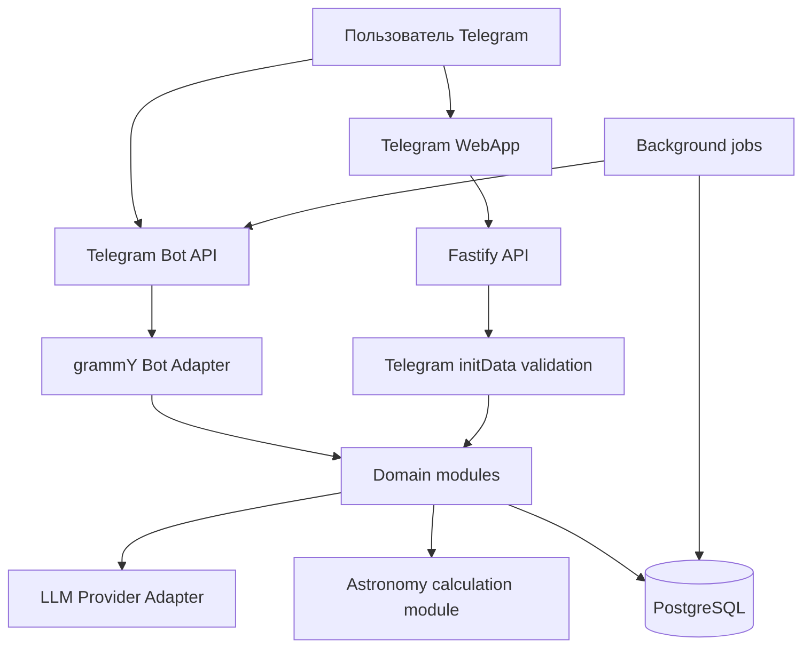

# Техническая архитектура

## Обзор

Архитектура — модульный монолит: один backend-процесс содержит HTTP API и Telegram Bot, доменные модули разделены внутри приложения. WebApp разворачивается как отдельный статический frontend.

## Workspace

- `apps/web`: React/Vite Telegram WebApp.
- `apps/server`: Fastify API, grammY Bot, фоновые задачи и доменные модули.
- `packages/shared`: общие типы, схемы API и DTO.
- `assets`: утверждённые превью, будущие иллюстрации Таро и астрологии.
- `docs`: согласованные требования и решения.

## Backend modules

| Модуль | Ответственность |
|---|---|
| auth | Проверка Telegram initData и сессия |
| users | Профиль и настройки |
| birth-data | Дата/время/место рождения и timezone |
| astrology | Планетарные положения, Асцендент, карта |
| tarot | Колоды, случайный выбор и типы раскладов |
| horoscope | Ежедневные и персональные тексты |
| ai-astrologer | Контекст, диалоги и LLM adapter |
| journal | Сохранённые результаты |
| entitlements | Права доступа и лимиты Free/Premium |
| payments | Telegram Stars и разовые покупки |
| notifications | Расписание и отправка уведомлений |
| analytics | События и метрики |
| admin | Конфигурация контента и лимитов |

## Astrology pipeline

1. Нормализовать местную дату/время и IANA timezone.
2. Преобразовать время в UTC.
3. Получить координаты места рождения.
4. Рассчитать положения небесных тел с Astronomy Engine.
5. Отдельно рассчитать Асцендент и выбранную систему домов.
6. Сохранить исходные параметры, версии алгоритма и результаты.
7. Передать рассчитанные значения в AI-контекст только для интерпретации.

Контрольные даты и сравнение с независимыми эфемеридами обязательны перед production. Неизвестное время рождения не заменяется фиктивным значением.

## AI request pipeline

Проверка тарифа/лимита → построение минимального контекста → вызов LLM adapter → проверка ответа → сохранение диалога и расхода → ответ пользователю. Неудачные запросы и повторные webhook updates должны обрабатываться идемпотентно.

## Payments

Для цифровых товаров и функций внутри Telegram — Telegram Stars (XTR). Сервер подтверждает pre-checkout и только после successful payment предоставляет entitlements. Платежи имеют уникальный идентификатор и защиту от двойной обработки.

## Deployment target

- Frontend: Cloudflare Pages (static build).
- API/Bot/PostgreSQL/jobs: EU VPS.
- Backups: независимое внешнее хранилище; тест восстановления до production.
- Secrets: environment variables; не коммитить в Git.

## Natal chart calculation pipeline

- Birth date and optional local time are stored separately from the IANA time zone.
- Local wall-clock time is resolved to UTC using IANA timezone rules. DST gaps are rejected; repeated local times are treated as ambiguous and do not produce a single Ascendant.
- Astronomy Engine calculates tropical geocentric ecliptic positions for Sun, Moon and the eight planets from Mercury through Pluto.
- If birth time is unavailable, the engine evaluates the possible local-day interval. It reports a sign only when that sign is stable across the full interval; exact degree, Ascendant and houses remain unavailable.
- Ascendant requires exact UTC instant plus birth latitude/longitude. No city geocoding provider is configured yet; coordinates can be supplied directly.
- The first house system is Whole Sign. House 1 begins at 0° of the zodiac sign containing the Ascendant.
- Calculated chart JSON is cached in `natal_charts` against a SHA-256 fingerprint of the source birth profile and algorithm version.
- Changing the source birth profile causes recalculation on the next chart request.
